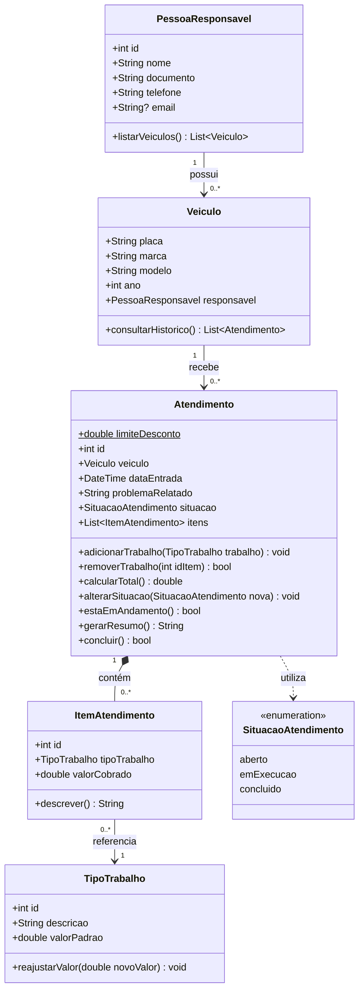

## Sobre a atividade

O objetivo desta etapa é transformar a modelagem em classes reais, organizadas em arquivos separados, aplicando os conceitos de:

- Orientação a objetos
- Encapsulamento (atributos privados, getters e setters)
- Construtores (`required`, parâmetros opcionais, valores padrão e `factory`)
- Mutabilidade (`final`, `const` e variáveis mutáveis)
- Relacionamentos entre objetos e coleções
- Conversão de dados (`toMap()` e `fromMap()`)

Não há interface gráfica nesta etapa.

**Classe entregue como totalmente implementada:** `Atendimento` (`lib/models/atendimento.dart`)

## Estrutura do projeto

```
oficina/
├── pubspec.yaml
├── README.md
├── bin/
│   └── main.dart
└── lib/
    ├── oficina.dart
    └── models/
        ├── atendimento.dart
        ├── item_atendimento.dart
        ├── pessoa_responsavel.dart
        ├── situacao_atendimento.dart
        ├── tipo_trabalho.dart
        └── veiculo.dart
```

| Arquivo | Responsabilidade |
|---|---|
| `pessoa_responsavel.dart` | Dados do cliente e lista dos veículos que ele possui |
| `veiculo.dart` | Dados do veículo, responsável e histórico de atendimentos |
| `atendimento.dart` | Ordem de serviço: situação, trabalhos realizados e total |
| `item_atendimento.dart` | Trabalho executado dentro de um atendimento, com o valor cobrado |
| `tipo_trabalho.dart` | Catálogo de serviços da oficina com valor padrão reajustável |
| `situacao_atendimento.dart` | Enum com as situações possíveis e as transições permitidas |
| `oficina.dart` | Exporta todas as classes do pacote |
| `main.dart` | Demonstração do uso das classes |

## Diagrama de classes



## Regras de negócio implementadas

| Regra | Como foi implementada |
|---|---|
| A placa do veículo não pode ser alterada | `placa` é `final` e não existe no `copyWith()` de `Veiculo` |
| A data de abertura do atendimento não pode ser alterada | `dataEntrada` é `final` e não existe no `copyWith()` de `Atendimento` |
| A situação do atendimento só aceita alterações válidas | `SituacaoAtendimento.podeMudarPara()` permite apenas Aberto → Em execução → Concluído (ou Aberto → Concluído). Concluído não muda mais |
| Os valores dos tipos de trabalho podem ser reajustados | `TipoTrabalho.reajustarValor()`, com validação de valor positivo |
| O total é calculado com base nos trabalhos | `Atendimento.calcularTotal()` soma o `valorCobrado` de cada item |
| Não é possível concluir sem pelo menos um trabalho | `concluir()` retorna `false`; `alterarSituacao()`, o construtor e o `fromMap()` lançam `StateError` |
| O `copyWith()` não pode violar a imutabilidade | Campos imutáveis ficam de fora do `copyWith()`, e a troca de situação passa pela mesma validação de transição |
| `toMap()` e `fromMap()` reconstroem os dados com os relacionamentos | Os mapas incluem os objetos relacionados aninhados e usam os nomes das colunas do modelo ER |

### Regras adicionais

- **Limite de desconto:** a constante `Atendimento.limiteDesconto` (10%) define o menor valor que pode ser cobrado por um trabalho em relação ao valor padrão.
- **Valor cobrado preservado:** o `ItemAtendimento` guarda o valor no momento em que o trabalho foi adicionado, então reajustar o `TipoTrabalho` não altera atendimentos já registrados.
- **Atendimento concluído é bloqueado:** não é possível adicionar ou remover trabalhos depois da conclusão.
- **Validações de entrada:** placa (padrão antigo e Mercosul), CPF/CNPJ pela quantidade de dígitos, telefone com DDD, e-mail, ano do veículo e campos de texto obrigatórios.
- **Relacionamentos sincronizados:** ao criar um `Veiculo`, ele é vinculado ao responsável; ao criar um `Atendimento`, ele entra no histórico do veículo.

## Recursos utilizados em cada classe

| Recurso | Pessoa | Veículo | Atendimento | Item | TipoTrabalho |
|---|:-:|:-:|:-:|:-:|:-:|
| Atributos privados com getters/setters | ✔ | ✔ | ✔ | | ✔ |
| Construtor com `required` e opcionais | ✔ | ✔ | ✔ | ✔ | ✔ |
| Construtor `factory` | ✔ | ✔ | ✔ | ✔ | ✔ |
| `copyWith()` | ✔ | ✔ | ✔ | ✔ | ✔ |
| `toMap()` / `fromMap()` | ✔ | ✔ | ✔ | ✔ | ✔ |
| `toString()` | ✔ | ✔ | ✔ | ✔ | ✔ |
| Métodos de negócio | ✔ | ✔ | ✔ | ✔ | ✔ |

## Como executar

Pré-requisito: [Dart SDK](https://dart.dev/get-dart) 3.0 ou superior.

```bash
git clone https://github.com/SEU_USUARIO/oficina.git
cd oficina
dart pub get
dart run
```

Para verificar se o código está sem erros:

```bash
dart analyze
```

## Exemplo de uso

```dart
final pessoa = PessoaResponsavel(
  id: 1,
  nome: 'Carlos Silva',
  documento: '123.456.789-09',
  telefone: '(45) 99999-1234',
);

final veiculo = Veiculo(
  placa: 'ABC1D23',
  marca: 'Volkswagen',
  modelo: 'Gol',
  ano: 2018,
  responsavel: pessoa,
);

final trocaOleo = TipoTrabalho(id: 1, descricao: 'Troca de óleo', valorPadrao: 150);

final atendimento = Atendimento(
  id: 1,
  veiculo: veiculo,
  problemaRelatado: 'Barulho ao frear',
);

atendimento.alterarSituacao(SituacaoAtendimento.emExecucao);
atendimento.adicionarTrabalho(trocaOleo);
atendimento.concluir();

print(atendimento.gerarResumo());
```
